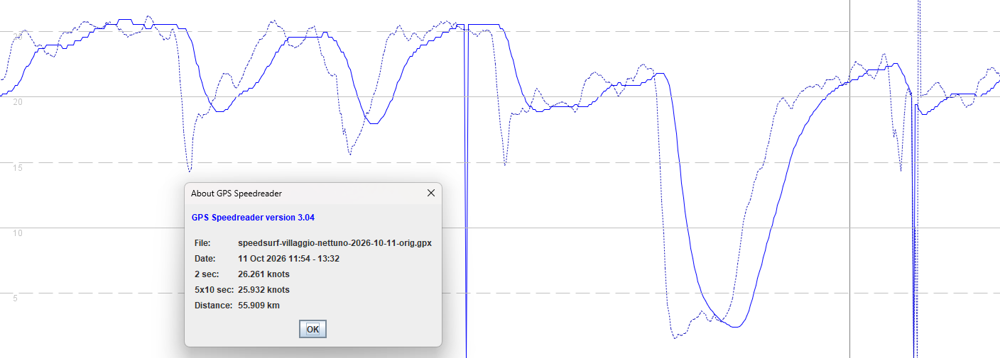

## Amazfit T-Rex 2

### Overview

The Amazfit T-Rex 2 was released in May 2022 and provides multi-band GNSS.

Only one session has been examined, but it shows big issues with this watch when used for speedsurfing. 


### Data Quality

The Amazfit watches do not provide FIT exports, so the GPX files must be used.

The image below shows the speeds in the PGX (solid line) vs the position-derived speeds (dotted line).



Several points are immediately obvious:

- The speeds are lagged and massively smoothed
- There are lots of flat spots and repeated speeds
- Speed is occasionally missing and showing as zero

The biggest issue is the smoothing because it adversely affects the alpha 500 and gybe scoring. The fastest alpha 500 (position-derived) is 21.29 kt but using the speeds in the GPX is 23.99 kt. The position-derived alpha 500 of 21.29 kt is probably the most realistic, but there is no way to know the true result without a benchmark device. The speeds in the FIT are not reflecting the slowest parts of the gybes, so the alpha 500 is inflated.

The smoothing also causing big issues for gybe scoring on speedsurfing.app, and this session is currently the top session in the leaderboard. The reason for the high gybe score is not the quality of the gybe, but the fact that the speeds in the GPX have been so heavily smoothed. The min speeds are unrealistically high, and the difference between entry speed and exit speed is reduced. This massively inflates gybe scores for this device.


### Issues

It is clear that speeds from the T-Rex 2 are not realistic, and this could be true for other Amazfit watches. The smoothing means that alpha 500 and gybe scores cannot be trusted from this device, and quite possibly other Amazfit watches.

The GPX file does not contain the Doppler-derived speeds from the GNSS receiver inside the watch. Whether this is due to how the activity has been recorded is yet to be confirmed. Perhaps it was due to the use of a sport mode that is not appropriate?


### GPX Compliance

The GPX header is incorrect:

```xml
<gpx creator="Amazfit T-Rex 2"
     version="1.1"
     xmlns="http://www.topografix.com/GPX/1/1"
     xmlns:xsi="http://www.w3.org/2001/XMLSchema-instance"
     xmlns:ns1="http://www.cluetrust.com/XML/GPXDATA/1/0"
     xmlns:ns2="http://www.garmin.com/xmlschemas/GpxExtensions/v3"
     xmlns:ns3="http://www.garmin.com/xmlschemas/TrackPointExtension/v1"
     xsi:schemaLocation="http://www.topografix.com/GPX/1/1
                         http://www.topografix.com/GPX/1/1/gpx.xsd">
```

`TrackPointExtension/v1` needs to be `v2`, and clutter should be removed - e.g. `GPXDATA/1/0` and `GpxExtensions/v3`:

```xml
<?xml version="1.0" encoding="UTF-8"?>
<gpx creator="Amazfit T-Rex 2"
     version="1.1"
     xmlns="http://www.topografix.com/GPX/1/1"
     xmlns:xsi="http://www.w3.org/2001/XMLSchema-instance"
     xmlns:ns3="http://www.garmin.com/xmlschemas/TrackPointExtension/v2"
     xsi:schemaLocation="http://www.topografix.com/GPX/1/1
                         https://www.topografix.com/GPX/1/1/gpx.xsd
                         http://www.garmin.com/xmlschemas/TrackPointExtension/v2
                         https://www8.garmin.com/xmlschemas/TrackPointExtensionv2.xsd">
```

