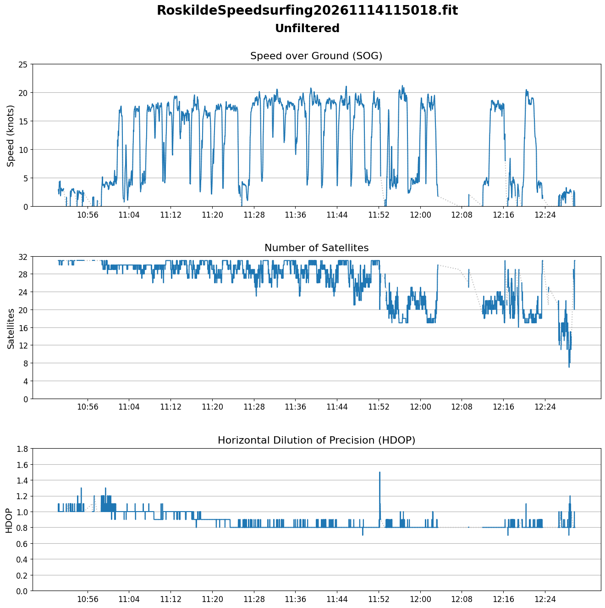
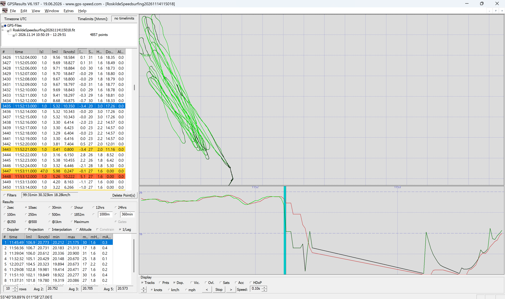

## 3.2108.0 - 2 Nov 2026

### Overview

The [release notes](https://support.coros.com/hc/en-us/articles/42682214780820-COROS-APEX-4-42-and-APEX-4-46-Release-Notes) for FW 3.2108.0 include the following statement:

> Additional bug fixes and performance optimizations.

These fixes include the re-introduction of several developer fields:

- Index - idx
- Satellites - Sat
- Horizontal Dilution of Precision - hdop
- Course Over Ground - cog

This document will quickly review the developer fields in 3.2108.0.

### Review of APEX 4

The charts below show a session from 14 Nov 2026 for FW 3.2108.0 and COROS app 4.11.8.

#### Sats

Number of satellites appears to reflect the total number of satellites in use. The number of satellites was shown earlier in this document, and 32 appears to be the maximum for the APEX 4 which uses the Synaptics SYN4778.

It is good to see the sudden loss of satellites during a crash (30 to 20 in one second), suggesting it really is the number of satellites currently in use:

#### HDOP

HDOP starts off between 1.0 and 1.3, but settles between 0.8 and 0.9 for most of the session.

It is also worth noting that GPSResults contains a bug and is doubling the HDOP values.

#### COG

Course Over Ground (COG) is also present in the FIT file, albeit without any decimal places.

Ideally COG would have two decimal places for the benefit of downstream processing.

### Next Steps

- Consider improvements to existing filters
  - Sudden loss of satellites - e.g. 30 to 20 within a few seconds may be a crash
- Compare the actual speed data of the APEX 4 against a suitable benchmark device
  - Ideally a Motion or ESP, but next best would be GW-60, GW-52, or GW-31
- Report bugs in GPSResults
  - HDOP is being doubled and gets confused by more than 32 sats - e.g. Apex 2 Pro

