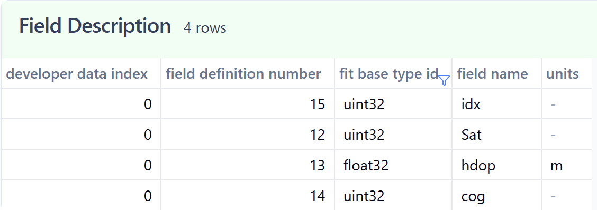
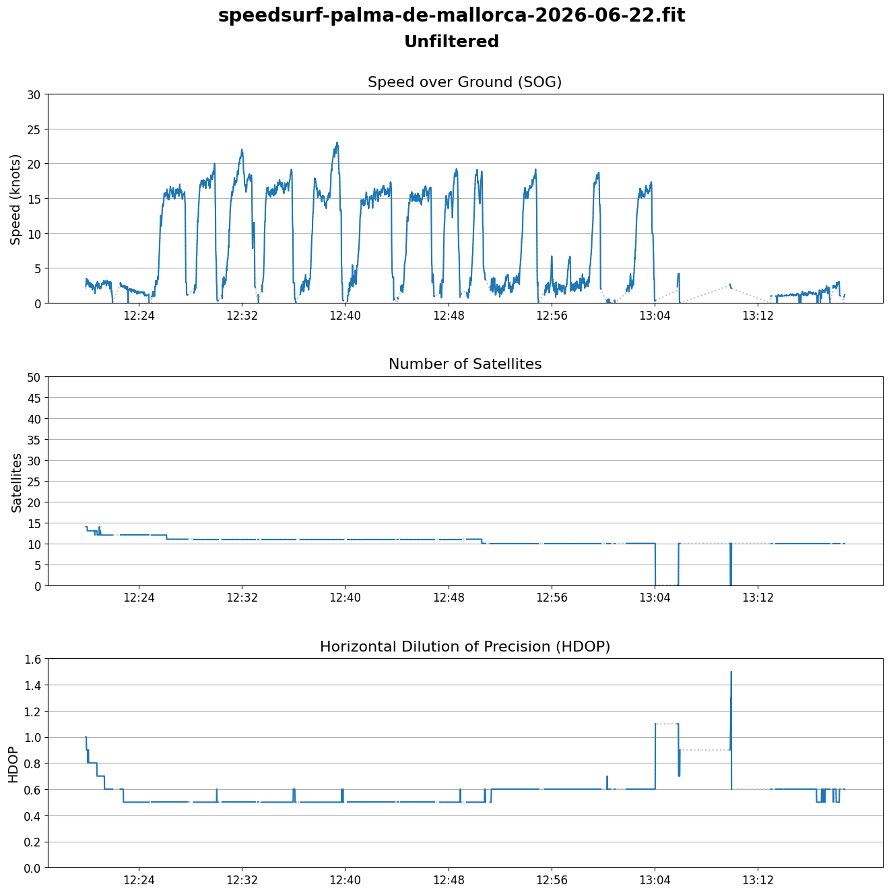
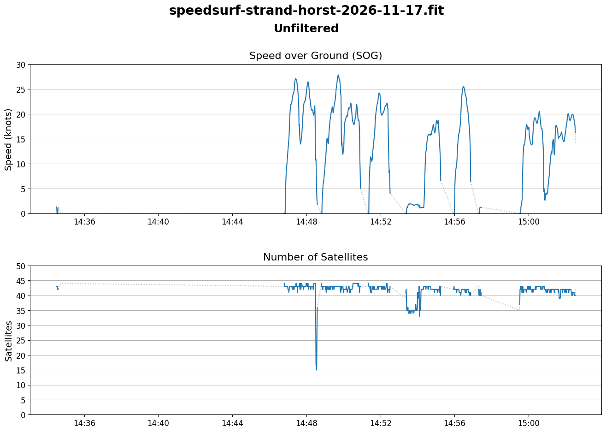
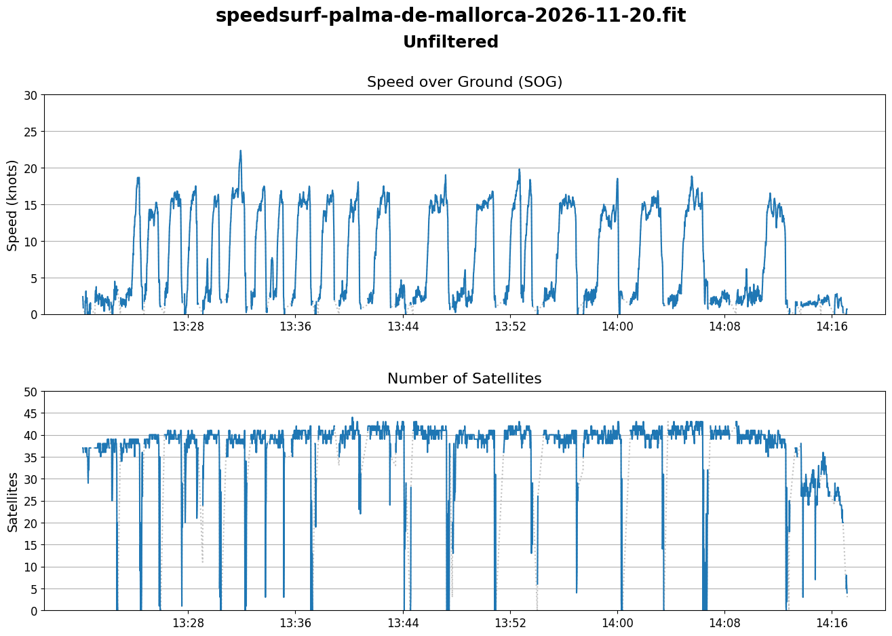

## COROS - Satellites

Author: Michael George

Created: 21 Nov 2026

### Overview

COROS watches have traditionally recorded the following developer fields in their FIT files:

- Index - idx
- Satellites - Sat
- Horizontal Dilution of Precision - hdop
- Course Over Ground - cog

Firmware 3.1708.0 to 3.2008.0 were missing all of these fields, but some were re-added in 3.2108.0.

This document describes the behaviour prior to 3.1708.0, and after 3.2108.0.

- idx + Sat + cog have been re-instated in 3.2108.0
- hdop is still missing in 3.2108.0
- Sat now has a different meaning - which is actually an improvement 

### Prior to FW 3.1708.0

#### APEX 2 Pro

This FIT file generally reported 12 satellites, presumably just the visible GPS satellites.

The FIT file contained all 4 developer fields:

#### VERTIX 2S

This FIT file generally reported 10 or 11 satellites, presumably just the visible GPS satellites.

The FIT file contained all 4 developer fields:

### FW 3.2108.0

#### APEX 2 Pro

This FIT file reported a variable number of satellites during the session, presumably the L1 + L5 signals currently in use.

The FIT file contained only 3 developer fields, and hdop (definition #13) was missing:

#### VERTIX 2S

This FIT file reported a variable number of satellites during the session, presumably the L1 + L5 signals currently in use.

The FIT file contained only 3 developer fields, and hdop (definition #13) was missing:

### Summary

Firmware 3.2108.0 is a welcome improvement:

- idx + Sat + cog have been re-instated
- Sat appears to represent the number of L1 + L5 signals in use 

However there is still work to be done:

- hdop is still missing in 3.2108.0

