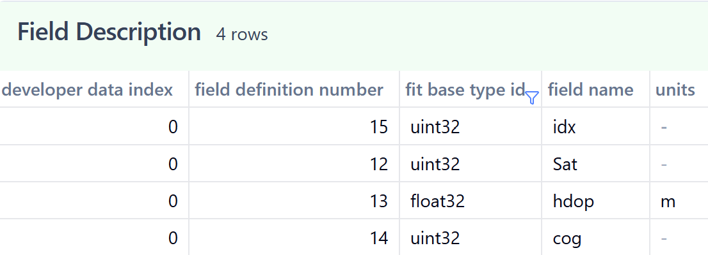
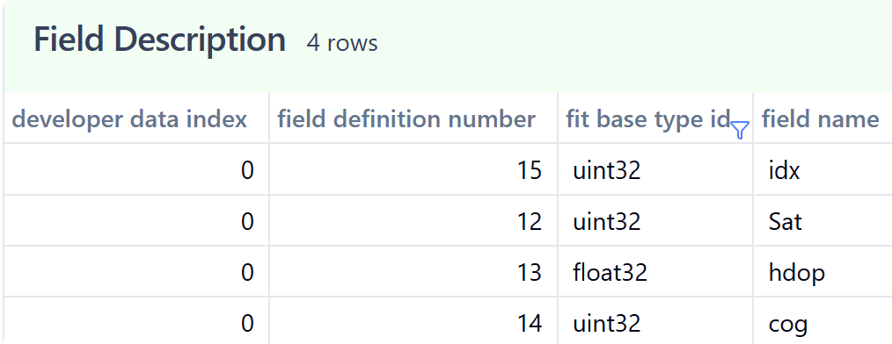

## COROS - Satellites

Author: Michael George

Created: 21 Nov 2026

### Overview

COROS watches have traditionally recorded the following developer fields in their FIT files:

- Index - idx
- Satellites - Sat
- Horizontal Dilution of Precision - hdop
- Course Over Ground - cog

Firmware 3.1708.0 to 3.2008.0 were missing all of these fields, but some were re-added in 3.2108.0.

This document describes the behaviour prior to 3.1708.0, and after 3.2108.0.

- idx + Sat + cog have been re-instated in 3.2108.0
- hdop is still missing in 3.2108.0
- Sat now has a different meaning - which is actually an improvement 

### Prior to FW 3.1708.0

#### APEX 2 Pro

This FIT file generally reported 12 satellites, presumably just the visible GPS satellites.

The FIT file contained all 4 developer fields:

#### VERTIX 2S

This FIT file generally reported 10 or 11 satellites, presumably just the visible GPS satellites.

The FIT file contained all 4 developer fields:

### FW 3.2108.0

#### APEX 2 Pro

This FIT file reported a variable number of satellites during the session, presumably the L1 + L5 signals currently in use.

The FIT file of the APEX 2 Pro contained only 3 developer fields, and hdop (definition #13) was missing:

#### VERTIX 2

This FIT file reported a variable number of satellites during the session, presumably the L1 + L5 signals currently in use.

The FIT file of the VERTIX 2 contained all 4 developer fields:

#### VERTIX 2S

This FIT file reported a variable number of satellites during the session, presumably the L1 + L5 signals currently in use.

The FIT file of the VERTIX 2S contained only 3 developer fields, and hdop (definition #13) was missing:

#### APEX 4

This FIT file reported a variable number of satellites during the session, presumably the ones currently in use.

The number of satellites for the APEX 4 (Synaptics SYN4778) differs from the APEX 2 Pro + VERTIX 2S (Airoha AG3335M).

The FIT file of the APEX 4 contained all 4 developer fields:

### Summary

Firmware 3.2108.0 is a welcome improvement:

- idx + Sat + cog have been re-instated in 3.2108.0
- Sat appears to represent the number of L1 + L5 signals in use 
- Sat counts for APEX 4 (Synaptics SYN4778) differ from APEX 2 Pro + VERTIX 2S (Airoha AG3335M)

There is still work to be done by COROS, specifically relating to hdop (definition #13):

- hdop has been re-instated for some watches in 3.2108.0 - e.g. APEX 4 + VERTIX 2
- hdop is still missing for some watches in 3.2108.0 - e.g. APEX 2 Pro + VERTIX 2S
- It is yet to be confirmed which COROS watches are still missing hdop

