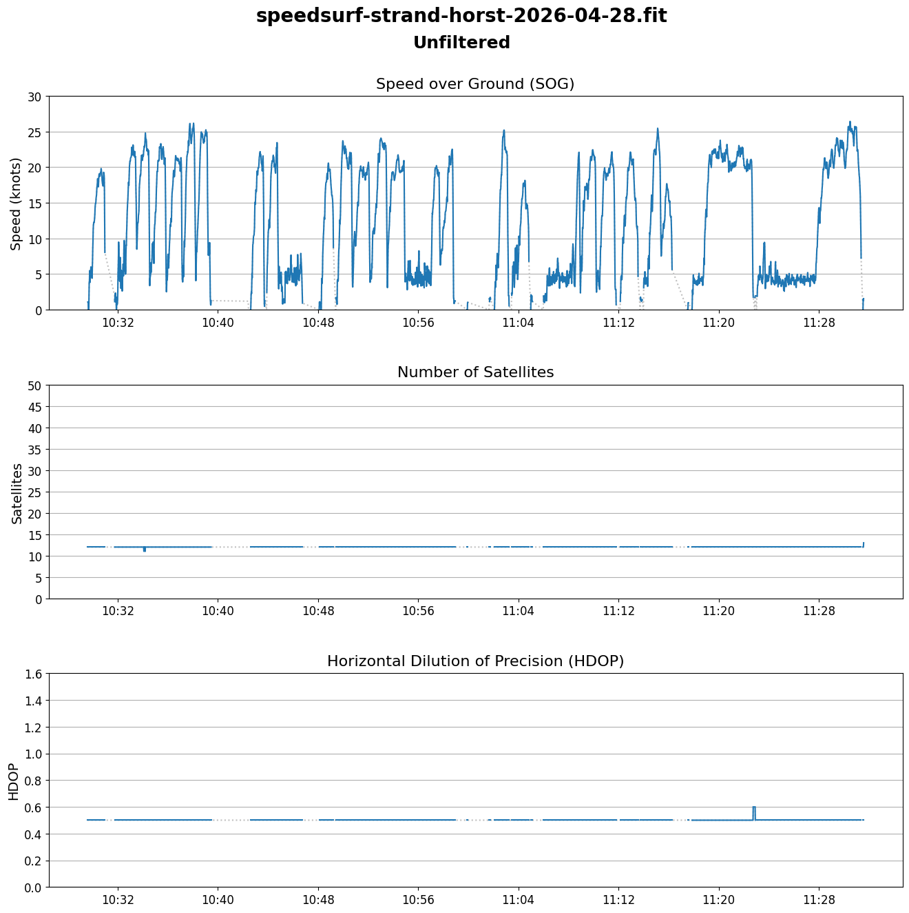
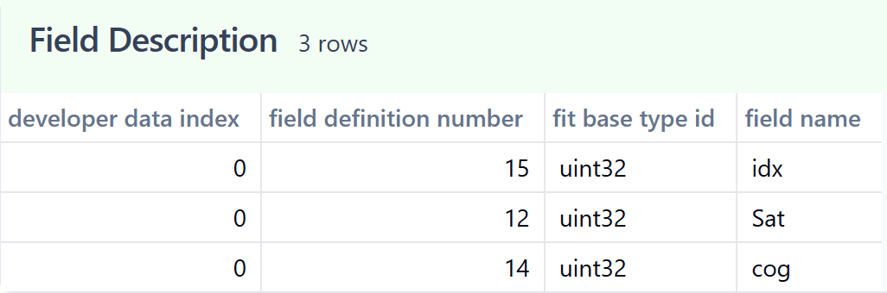
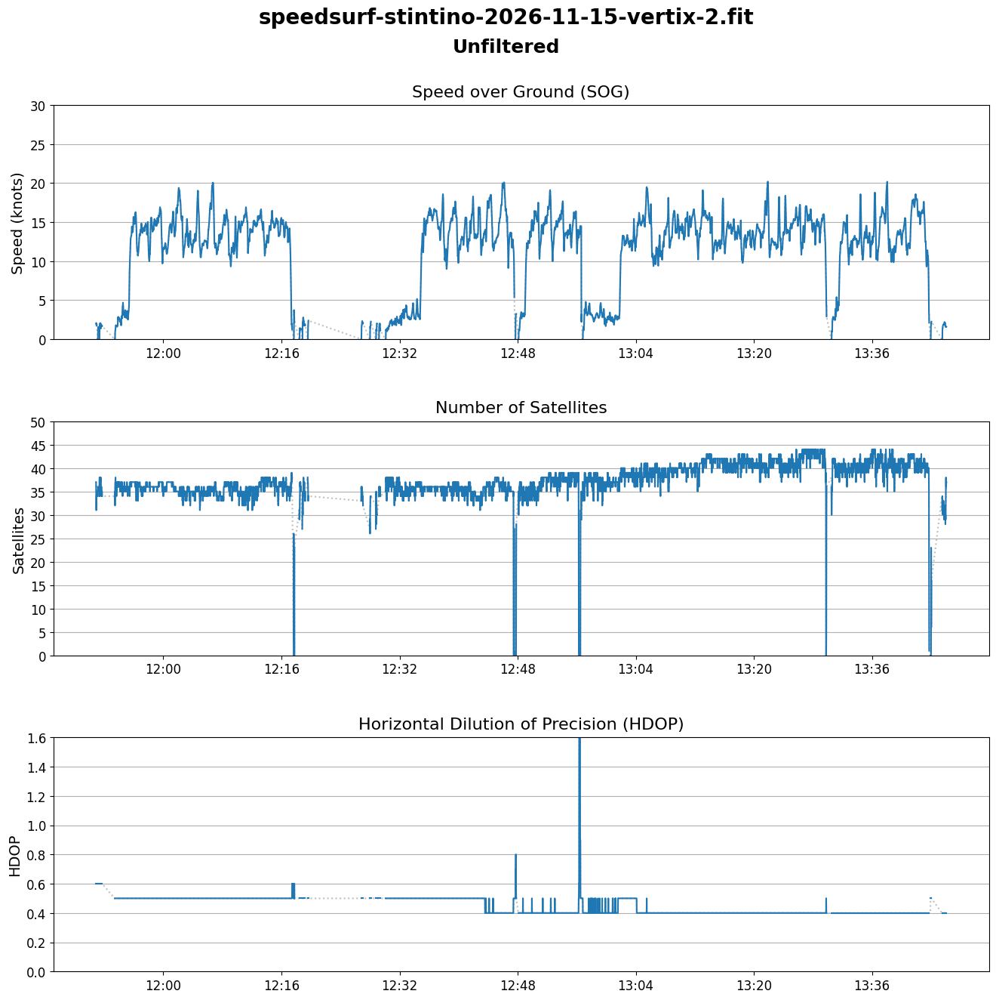
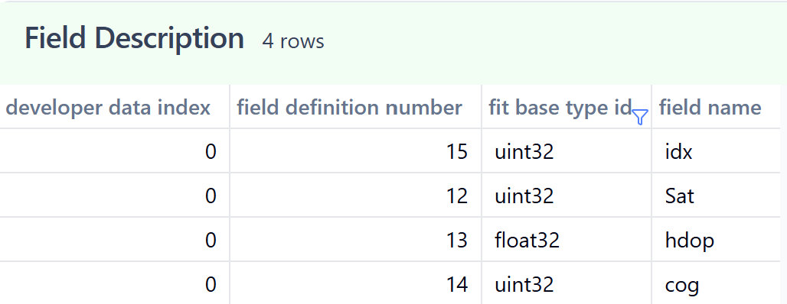
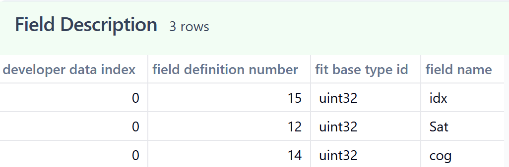

## COROS - Satellites

Author: Michael George

Date created: 21 Nov 2026

Last updated: 26 Nov 2026

### Overview

COROS watches have traditionally recorded the following developer fields in their FIT files:

- Index - idx
- Satellites - Sat
- Horizontal Dilution of Precision - hdop
- Course Over Ground - cog

Firmware 3.1708.0 to 3.2008.0 were missing all 4 of these fields, but they were re-added in 3.2108.0.

### TLDR

COROS have told users to upgrade their watch to 3.2108.0 and COROS app to 4.11.8.

This document summarises the behaviour prior to 3.1708.0, and after 3.2108.0.

- idx + Sat + hdop + cog have been re-instated in 3.2108.0
- Sat now has a different meaning - which is actually an improvement 

### Prior to FW 3.1708.0

#### APEX 2 Pro

This FIT file generally reported 12 satellites, presumably just the visible GPS satellites.

The FIT file contained all 4 developer fields:

#### VERTIX 2S

This FIT file generally reported 10 or 11 satellites, presumably just the visible GPS satellites.

The FIT file contained all 4 developer fields:

### FW 3.2108.0

#### APEX 2 Pro

This FIT file reported a variable number of satellites during the session, presumably the L1 + L5 signals currently in use.

The FIT file of the APEX 2 Pro contained only 3 developer fields, and hdop (definition #13) was missing:

Note that similar sessions were seen for the VERTIX 2S but they subsequently acquired hdop.

#### VERTIX 2

This FIT file reported a variable number of satellites during the session, presumably the L1 + L5 signals currently in use.

The FIT file of the VERTIX 2 contained all 4 developer fields:

The VERTIX 2 appears to be fine with regards the 4 developer fields.

#### VERTIX 2S

This FIT file reported a variable number of satellites during the session, presumably the L1 + L5 signals currently in use.

The FIT file of the VERTIX 2S contained only 3 developer fields, and hdop (definition #13) was missing:

Note that other users saw all 4 developer fields in their VERTIX 2S files - see files from [Hannes](https://speedsurf.app/profile/b885ceda-504a-4333-bf93-6dd94e2ae028).

#### APEX 4

This FIT file reported a variable number of satellites during the session, presumably the ones currently in use.

The number of satellites for the APEX 4 (Synaptics SYN4778) differs from the APEX 2 Pro + VERTIX 2S (Airoha AG3335M).

The FIT file of the APEX 4 contained all 4 developer fields:

### Summary

Firmware 3.2108.0 is a welcome improvement:

- idx + Sat + hdop + cog have been re-instated in 3.2108.0
- Sat appears to represent the number of L1 + L5 signals in use 
- Sat counts for APEX 4 (Synaptics SYN4778) are higher than the APEX 2 Pro (Airoha AG3335M)

I have yet to observe hdop re-introduced for the APEX 2 and APEX 2 Pro.
