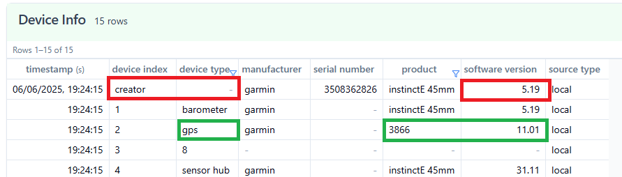
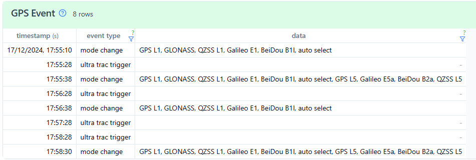
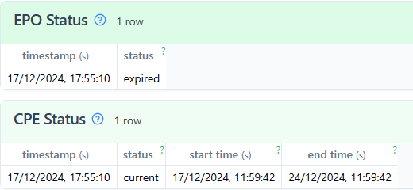
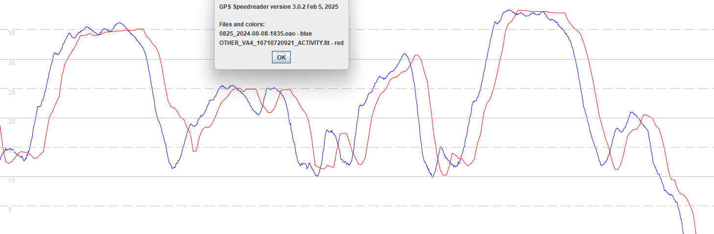
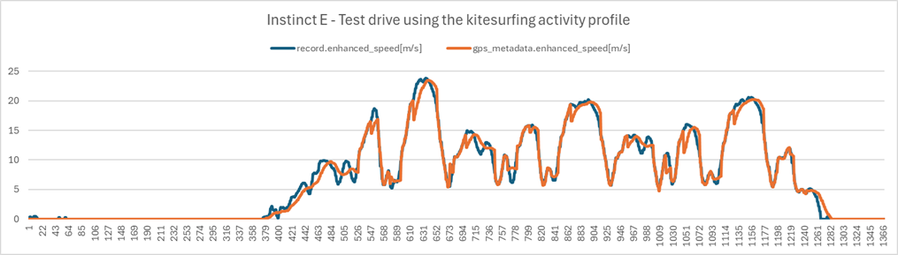
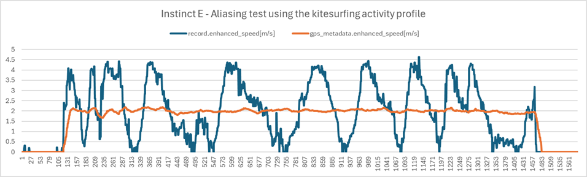

## Garmin - Identifying GNSS Chipsets

Author: Michael George

Created: 7 Jun 2025

Updated: 10 Nov 2026

### Introduction

The GNSS chipset is probably the most significant factor when it comes to the accuracy and reliability of GPS watches. Additional factors include antenna design, GNSS firmware, watch firmware, and user settings. The activity profile and / or app choice are also really important.

This page provides some details about the different GNSS chipsets used in Garmin watches, including their unique traits and means of identification. A separate page lists most of the Garmin watches and their GNSS chipset. The list of Garmin watches is available via this [link](../watches/README.md).

#### GNSS Chipsets

The following GNSS chipsets are known to have been used in Garmin watches:

- SiRFstarII, SiRFstarIII, SiRFstarIV
- MediaTek MT3333
- Sony CXD5603GF, CXD5605GF
- Airoha AG3335M, AG3335MN, AG3352
- Synaptics SYN4778

#### Identification Tricks

Various pieces of information can be helpful when trying to ascertain the GNSS chipset inside a Garmin watch.

- Physical teardown
  - Federal Communications Commission ([FCC](https://fccid.io/IPH))
  - Third parties
- Product specification + manual
  - GNSS capabilities
- Device information
  - System software version
  - GPS product number
  - GPS software version
- Additional information
  - GPS events
  - EPO status / CPE Status
  - Recorded speeds
  - GPS metadata

The following sections will describe each of the topics individually.

### Physical Teardown

Physical teardowns can provide definitive proof about what is inside a specific watch.

#### Federal Communications Commission (FCC)

The Federal Communications Commission (FCC) show internal photos, but only 6 months after the application date.

- [Garmin International Inc](https://fccid.io/IPH) - FCC Grantee Code IPH

#### Third Parties

The Garmin Rumors website has two useful pages:

- [Inside every Garmin](https://garminrumors.com/teardowns/) - Teardown photos and the chips
- [The chips inside every Garmin](https://garminrumors.com/teardowns/chips/) - Every chip we could read off the inside photos

Links to numerous third party teardowns are also on this site:

- [Garmin Watches](../watches/README.md) - Models within different watch families

### Product Specification + Manual

#### GNSS Capabilities

If the product specification states the battery life for "GPS only" and "All Systems" then it is almost certainly using Airoha or Synaptics.

The satellite settings described in the user manual can also provide a clue:

- "GPS + GLONASS" or "GPS + Galileo" will be SiRF, MediaTek or Sony.
- "All Systems" will be Airoha or Synaptics.
- "All Systems + Multi-Band" will be the Airoha AG3335M or Synaptics SYN4778.
- Likewise for SatIQ which is dependent on multi-band.

The presence (or absence) of BeiDou and QZSS in the product specification does not tell us anything. All of the Airoha-based watches support BeiDou and QZSS, which can easily be confirmed by looking at the mode_change records in gps_event records within their FIT files. The omission of BeiDou and QZSS on the product pages is simply an oversight on the Garmin website.

e.g. The vívoactive 5 and vívoactive 6 both support BeiDou and QZSS, despite it only being mentioned for the vívoactive 6.

### Device Information

#### System Software Version

The device_info records in the FIT file are a good source of information. The example below is from the Instinct E using the online [Fit File Viewer](https://www.fitfileviewer.com/).

The system software version (creator device) is often identical on a number of related watches:

- fenix 8 AMOLED, Fenix 8 Solar, Enduro 3, fenix E, and Tactix 8
- fenix 7 and 7 Pro, Epix and Epix Pro (42mm/47mm/51mm), Enduro 2, Quatix 7, and MARQ Gen 2
- Forerunner 965, 955, 265, 255, 165
- Instinct 3 Solar, Instinct 3 AMOLED, and Instinct E
- Venu 3, Venu 3S, and Vivoactive 5

There is a possibility of related watches (i.e. identical system software) using the same brand of GNSS chipset.

This does NOT always hold true though, so you cannot make assumptions:

- Instinct 2 (Sony) vs Instinct 2X (Airoha)
- Instinct 3 (Airoha) vs Instinct Crossover AMOLED (Synaptics)
- fenix E (Airoha) vs fenix 8 (Synaptics)
- Forerunner 70 / 170 (Airoha) vs Forerunner 570 / 970 (Synaptics)
- Forerunner 55 (Sony) vs Forerunner 255 (Airoha)
- vívoactive 6 (Airoha) vs Venu 4 (Synaptics)

#### GPS Product Number

There is a GPS product number (e.g. 3866 = Airoha AG3335MN) which is described on another page, available via this [link](products.md).

Beware though because the fenix 7 Sapphire incorrectly lists the GNSS product number as 3866 (AG3335MN), despite being multi-band.

Sadly most of the newer watches (e.g. fenix 8 and newer) have dispensed with this differentiator, and re-use their main product number.

#### GPS Software Version

Different watch ranges may be using the same brand of GNSS chipset if they receive identical GPS software versions.

e.g. Fenix 7 and 7 Pro, Epix and Epix Pro, Enduro 2, Quatix 7, MARQ Gen 2, Forerunner 965, 955, 265, 255, 165 all had GPS software 13.00 at one time.

The GPS software version can also be a good differentiator of watches. e.g. 8.07 for the Instinct2X (Airoha) vs 6.10 for the Instinct 2 (Sony).

### Additional information

#### GPS Events

The gps_event records were introduced in the Sony-era of Garmin watches and can be a useful diagnostic tool. The example below shows "all systems" being used by the Venu 3S. It cannot be the Sony chipset (which doesn't support all 5 systems concurrently) and worth noting that it supports BeiDou and QZSS, despite the product specification on Garmin's website.

Although the GNSS mode is chosen by the user, multi-band (L1 + L5) and SatIQ will always be evident when they are active.

All of the possible GNSS configurations are listed in the [Toybox.Position](https://developer.garmin.com/connect-iq/api-docs/Toybox/Position.html) documentation for Garmin developers.

QZSS is not selected by the user (or app developer) and is activated automatically by the Garmin watch, when applicable.

#### EPO / CPE Status

Another clue in the FIT file relates to the epo_status and cpe_status records. CPE records are only present for Airoha and Synaptics chipsets, but the absence of CPE can be misleading. The Instinct 2X and Venu Sq 2 both have the Airoha chipset but only have epo_status records. Nonetheless the presence of up-to-date CPE status indicates an Airoha or Synaptics chipset.

#### Recorded Speeds

Activity profiles such as windsurfing, kitesurfing and "other" are supposed to record the Doppler-derived speed from the GNSS chipset. The Sony chipset performs rather badly and one of its traits is exactly the same speed being repeated for several seconds, resulting in flat spots. The chart below shows a test drive for a [Motion GPS](https://www.motion-gps.com/motion) (blue, extremely precise logger with u-blox chipset recording at 5 Hz) and vívoactive 4 (red, Sony chipset). The highs and lows are not always accurate on the Sony and repeated speeds (flat spots) are obvious when looking at the actual data. It may not be so apparent for this particular test drive but it is very obvious in real windsurfing data.

#### GPS Metadata

The topic of GPS metadata will be described in more detail on a separate page, but older Airoha-based watches exhibit curious dips in the speed data during controlled tests such as test drives. This unusual approach to filtering is only implemented by Garmin in their Airoha-based watches.

Tests designed to produce [aliasing](../../../general/aliasing/README.md) artefacts during a brisk walk (with exaggerated swinging of arms) are also a useful because the resulting data differs greatly for the Sony, Airoha and Synaptics devices. This is just one such example for an Airoha-based Garmin watch.

I still need to document what Garmin are doing for each chipset and why I think it has been implemented that way in their GPS software. It's a slightly involved topic, but the observations that can be made provide useful insights into the likely GNSS chipset.

