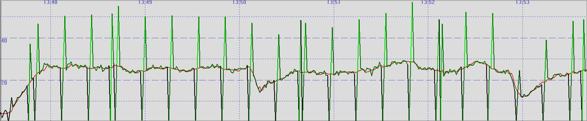

## Garmin FIT Files - Measured Speed

Author: Michael George

Created: 29 Oct 2026

### Background

It is relatively well known that [GNSS](https://en.wikipedia.org/wiki/Satellite_navigation) receivers are capable of calculating [Speed Over Ground](https://en.wikipedia.org/wiki/Ground_speed) (SOG) using the Doppler [observable](https://gssc.esa.int/navipedia/index.php/GNSS_Basic_Observables). The receiver must establish the [Doppler shifts](https://en.wikipedia.org/wiki/Doppler_effect) affecting the GNSS signals as part of the tracking process, and those Doppler-shifts can subsequently be used to determine the velocity of the receiver itself. The Doppler-derived speeds are typically a lot more accurate than position-derived speeds, and it makes them particularly important for sports such as speed sailing / speed surfing, and other high speed water sports.

It is possible to record the Doppler-derived speeds measured by Garmin watches for activities such as windsurfing, kiteboarding, wakeboarding, wakesurfing, and waterskiing. This contrasts with other water based activities such as kayaking, SUP, and surfing which employ heavy filtering of the speed data to eliminate any irrelevant changes in speed, largely due to the arm movements. The Doppler-derived speed data is present in several places within FIT files, and this document is a summary of the nuances. All examples come from the fenix 8 Pro.

This document will also touch on some of the issues and nuances that are unique to Garmin watches, and how the consequences can be mitigated. A recent beta firmware for the fenix 8 Pro appears to have dropped the "GPS metadata" which is particularly useful to speed sailing community, and probably affects other sports as well. In the absence of this "GPS metadata" it would be worth Garmin revisiting one of the long standing issues that is unique to their watches, and described within this document. Essentially, GNSS data can be skipped or duplicated due to a timing issue.

### FIT Contents

#### GPS Metadata

Within every Garmin watch is a GNSS chipset which is responsible for calculating [Position, Velocity, and Time](https://gssc.esa.int/navipedia/index.php/GNSS_Receivers_General_Introduction). Over time the manufacturer of the GNSS chipsets has varied - e.g. SiRF, MediaTek, Sony, Airoha, and Synaptics. Since the advent of the fenix 6 the speeds calculated by the GNSS chipset have been recorded in the FIT file as GPS Metadata. This is evident in tools such as the [FIT File Viewer](https://www.fitfileviewer.com/), which makes it easy to compare the speeds in GPS Metadata against the speeds within the main FIT records. This method of comparison is useful in establishing which activities are actually recording the Doppler-derived speeds within the main FIT records, and which activities are applying filtering / smoothing.

GPS Metadata uses the name `enhanced_speed`, but this simply relates to the field type being a 32-bit integer. The word "enhanced" relates to the legacy of speeds in FIT files using 16-bit integers, prior to the "enhanced" 32-bit integers. GPS Metadata records are only written to the FIT when `Toybox.Position.Quality` is considered "good", and the speed is greater than or equal to 0.447 m/s which is ~1 mph. Speeds of zero are recorded if the value is less than 0.447 m/s, and there is no obvious use of intermediate units or unexpected [quantization](https://en.wikipedia.org/wiki/Quantization_(signal_processing)). There are no timestamps present for the GPS Metadata, so neighbouring FIT records must be used to determine the approximate timing.

Good quality GNSS navigation solutions (i.e. [`Toybox.Position.Quality = 4`](https://developer.garmin.com/connect-iq/api-docs/Toybox/Position.html#Quality-module)) are recorded in GPS Metadata, regardless of whether there are issues affecting the persistence of `enhanced_speed` in the FIT record, or persistence of `Toybox.Position.Info.speed` within developer fields. This makes GPS metadata extremely useful for activities that are reliant on solid 1 Hz recording of speed data, and where the persistence issue within the standard FIT records is problematic. The concept of FIT persistence is described throughout this document. One final note is that GPS Event records will typically record when the GNSS signals are lost, and re-established. This is useful when identifying gaps in the GPS Metadata.

Note: This page will not discuss the nuances relating to GPS Metadata from the Airoha watches such the fenix 7 series and Forerunner x55 series. Those specific watches record GPS metadata where the speeds have been filtered / smoothed. The same smoothing has been evident on watches and GPS loggers from other brands using similar GNSS chipsets.

#### Toybox.Position.Info

Connect IQ apps can access the speed data from the GNSS chipset via `Toybox.Position.Info` and this can subsequently be recorded in developer fields via `Toybox.FitContributor`. It should be noted that when writing developer fields to the FIT file there is no guarantee that the timing of [Toybox Location events](https://developer.garmin.com/connect-iq/api-docs/Toybox/Position.html#enableLocationEvents-instance_function)  is suitable for the [FIT contributor](https://developer.garmin.com/connect-iq/api-docs/Toybox/FitContributor/Field.html). Values that are known to location events may be missing in the FIT file if they are overwritten before being written to the FIT, or repeated if the next location event occurs slightly later than expected. This is essentially the same persistence issue that affects standard FIT fields such as latitude, longitude, and speed.

It is worth noting that [quantization](https://en.wikipedia.org/wiki/Quantization_(signal_processing)) is evident for `Toybox.Position.Info.speed` and values are essentially multiples of ~0.00933 m/s. This applies to all of the Garmin watches and suggests standardised units internally. The reason that it is a multiple of ~0.00933 m/s will be summarised in the appendices at the end of this document, since it is not important right now. What is relevant is that the minimum value that is reported by `Toybox.Position.Info.speed` is ~0.00933 m/s, thus providing access to the the speeds that are recorded as zero in the standard `enhanced_speed` field. The biggest issue is that there is no way to reliably record 1 Hz speeds in developer fields.

#### FIT Record

The main FIT records include latitude, longitude, and speed from the GNSS chipset. Some of the Garmin activity types apply filtering / smoothing to these fields, but all of the high speed water sports record unfiltered values from the GNSS chipset. Quantization is clearly evident (just like `Toybox.Position.Info.speed`), but further compounded by the field precision of 0.001 m/s. If you extract all of the distinct values of `enhanced_speed`  you will see a increases of 0.009, 0.009, 0.010 between the unique values (i.e. averaging ~0.00933). When comparing the values of `enhanced speed` in FIT records against the corresponding `GPS Metadata`, they will be up to 0.009 m/s less due to the quantization.

The standard FIT records do not allow speeds less than 0.196 m/s to be recorded, which is around 0.7 km/h. These low speeds are recorded as zero in `enhanced_speed`, but they can be obtained via `Toybox.Position.Info.speed` and recorded in a developer field. The big issue with latitude, longitude, and speed in the FIT records is that they suffer from the FIT persistence issue that has already been mentioned in this document. The timing of location events does not lend itself to reliable 1 Hz recording, and values can either be repeated, or skipped entirely. One of the easiest ways to illustrate this is to overlay the Doppler-derived speeds and position-derived speeds.

The chart below shows the Doppler-derived speed in red, and position-derived speed in green. The tool is [GPS Results](https://gps-speed.com/gpsresults/) which has been the standard for analytics software within the speed sailing community for almost 20 years. This is just one way to illustrate the presence of the FIT persistence issue (duplicated values, and skipped values), but there are numerous consequences because it affects latitude, longitude, speed, and course. An example of this issue on the fenix 8 Pro will be provided in the appendices of this document. The one place where the reliable 1 Hz speed data can be found within Garmin FIT files is the GPS Metadata, but this has disappeared in the beta software 24.12 for the fenix 8 series.

#### Comparison

The table below gives a quick comparison of the speeds present in Garmin FIT files:

|                         |   GPS Metadata    | Toybox.Position.Info |      FIT Record      |
| ----------------------- | :---------------: | :------------------: | :------------------: |
| Timestamp               |        No         |   Yes 1   |   Yes 2   |
| Precision               |     0.001 m/s     |      0.001 m/s       |      0.001 m/s       |
| Quantisation            |       None        |     ~0.00933 m/s     |     ~0.00933 m/s     |
| Toybox.Position.Quality |       >= 4        |         >= 3         |         >= 3         |
| Minimum Value           | 0.447 m/s ≈ 1 mph |     0.00933 m/s      | 0.196 m/s ≈ 0.7 km/h |
| Reliable 1 Hz           |        Yes        |   No 3    |   No 3    |

Notes:

1. Toybox.Position.Info.when has an issue in that it is a truncated timestamp, not rounded. This causes duplicated "when" values, and missing "when" values for the GNSS navigation solutions.
2. Timestamps in the standard FIT records relate to when the FIT record was written, not the time of the GNSS navigation solution. The data typically lags behind the GNSS timestamps by 1 second, but sometimes they are in sync.
3. The FIT persistence issue is due to the timing of location events, and records being written to the FIT. Latitude, longitude, speed, and course in FIT records cannot be considered to be a reliable 1 Hz recording due to the persistence issue.

### FIT Persistence

The GNSS chipset is generating navigation solutions (i.e. position, velocity, time) once per second. These turn into location events which notify the CIQ application of the latest values, which can be written to the FIT as developer fields. The Garmin OS also writes latitude, longitude, and speed to the FIT file and a record is written to the FIT every second. The issue is that the timing of these two events is not always appropriate, and values can be either duplicated or skipped.

The earlier chart illustrated the presence of an issue by comparing the Doppler-derived speed in red, and position-derived speed in green. When the values of latitude and longitude are repeated the position-derived speed is zero. When the values of latitude and longitude are skipped, the next speed is doubled because the effective distance travelled is also doubled. This is an issue that affects all Garmin watches to some extent, but it is intermittent and does not affect every session.

Essentially the 1 Hz GNSS data is not being written to the FIT at 1 Hz. The [producer-consumer problem](https://en.wikipedia.org/wiki/Producer%E2%80%93consumer_problem) was first described in 1965, but there is usually a simple solution. The current approach for persisting latitude, longitude, and speed is not robust, and would benefit from a rethink. Since all of the newer watches use a common code base it would be nice if Garmin can give this issue some attention, and resolve the persistence issue.

Spotting persistence issues in FIT files is relatively straightforward for anyone wishing to work on the problem. Duplicate values for latitude, longitude, and speed are a clear giveaway when the watch is moving. Repeated values of speed in the GPS metadata is relatively uncommon (due to chance alone), unlike repeated values of latitude, longitude, and speed which are almost always an error when the watch is moving at speed.

This FIT persistence issue also applies to developer fields which are reliant upon location events. Whilst the location events should occur every second the timing can often vary, and this also causes FIT persistence issues. Whilst it is slightly more complicated to implement it would make sense to have a queue between the GNSS events and writing of records to the FIT file, so that all GNSS data is reliably recorded in the FIT file at a solid 1 Hz.

### Appendices

#### Example Data

The charts included in this document are from a fenix 8 Pro session on 6 Aug 2026.

Whilst that session is not using the latest beta software it nicely illustrates the FIT persistence issue which affects Garmin watches.

The fenix 8 Pro data also corroborates all of the minutia discussed throughout this document.

The fenix 8 Pro FIT file and some scrappy Excel investigations are all available on [Google Drive](https://drive.google.com/drive/folders/17fhgeGxQwVmOPaPi-sYByZLBMvqz-mEG?usp=sharing).

The folder on Google Drive includes a number of fenix 8 Pro sessions affected by the persistence issue on FW 22.x and 23.x.

#### Internal Units

This document mentioned quantization of speeds in `Toybox.Position.Info` and within the FIT records.

It is not unusual to use standardised units internally (e.g. m/s, km/h, mph, or knots), but what does 0.00933 m/s represent?

The short answer is that Garmin have chosen a unit that directly relates to their semicircle units for latitude and longitude.

Earth’s circumference / 232 = 2 * semi-major axis (WGS 84) * π / 232 = 0.009330692 meters.

The internal units for speed occurred to me after reading a discussion about Google maps on [Stack Exchange](https://gis.stackexchange.com/a/42423).

#### "When" Issue

It is also worth mentioning that there there is an issue with the GNSS timestamps reported by `Toybox.Position.Info`.

GNSS chips output the timestamp of the navigation solution [Position, Velocity, Time](https://gssc.esa.int/navipedia/index.php/GNSS_Receivers_General_Introduction) (PVT), but it is not always on the second. Due to the issue of clock drift, it is not unusual to see timestamps that are not always on the second - e.g. 09:28:15.999 then 09:28:17.000 then 09:28:17.999.

Since the `when` property is supposed to be the GNSS timestamp in seconds, it should be rounded to nearest second. Garmin are truncating the GNSS timestamps which results in missing timestamps, and duplicate timestamps as seen in the log files from [APPro Windsurf](https://apps.garmin.com/en-US/apps/9567700b-6587-44be-9708-879bfc844791).

Full details are documented on [Github](https://github.com/Logiqx/garmin-issues/issues/3) where I am recording Garmin issues that affect the speed sailing community.

#### Tools

The following tools have been used to evaluate the FIT data.

- [FitCSVTool.jar](https://github.com/garmin/fit-sdk-tools) by Garmin
- [FIT File Viewer](https://www.fitfileviewer.com/) by Harry Oosterveen
- [GPS Results](https://gps-speed.com/gpsresults/) by Manfred Fuchs
- [GPS Speedreader](https://github.com/prichterich/GPS-Speedreader) by Peter Richterich

