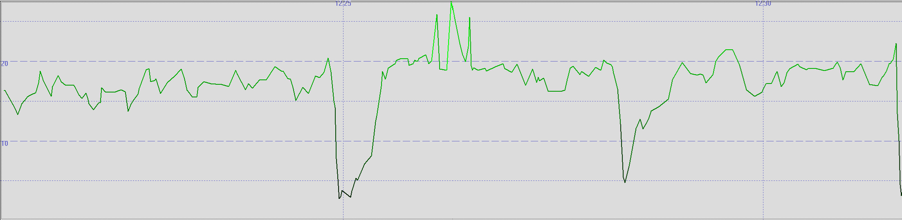
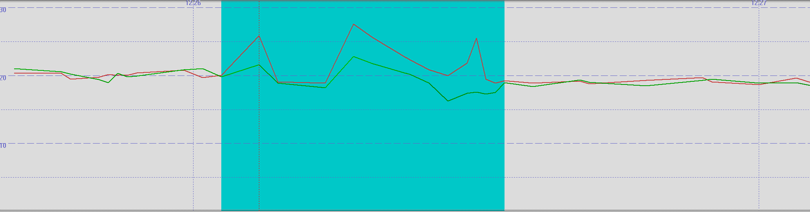
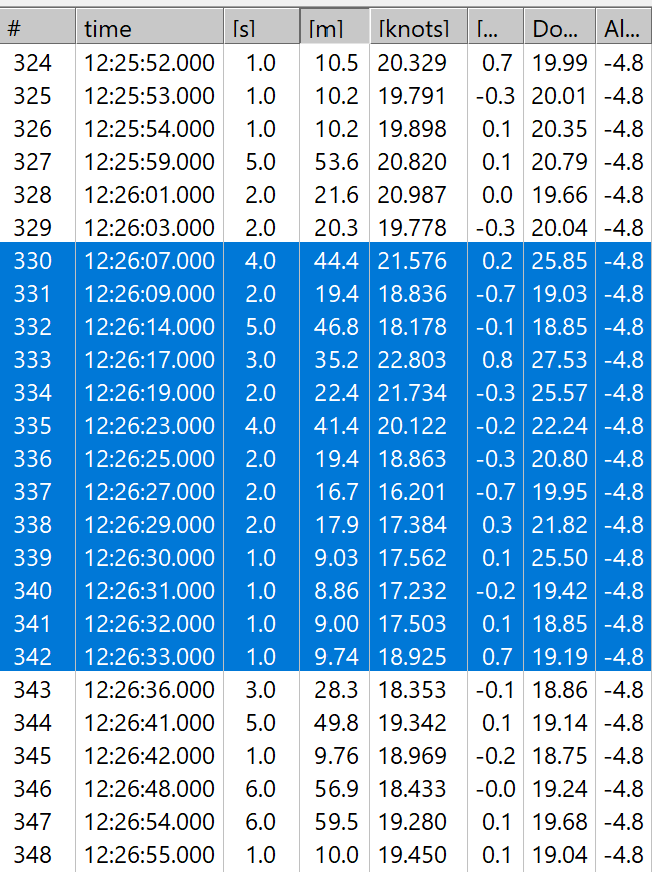
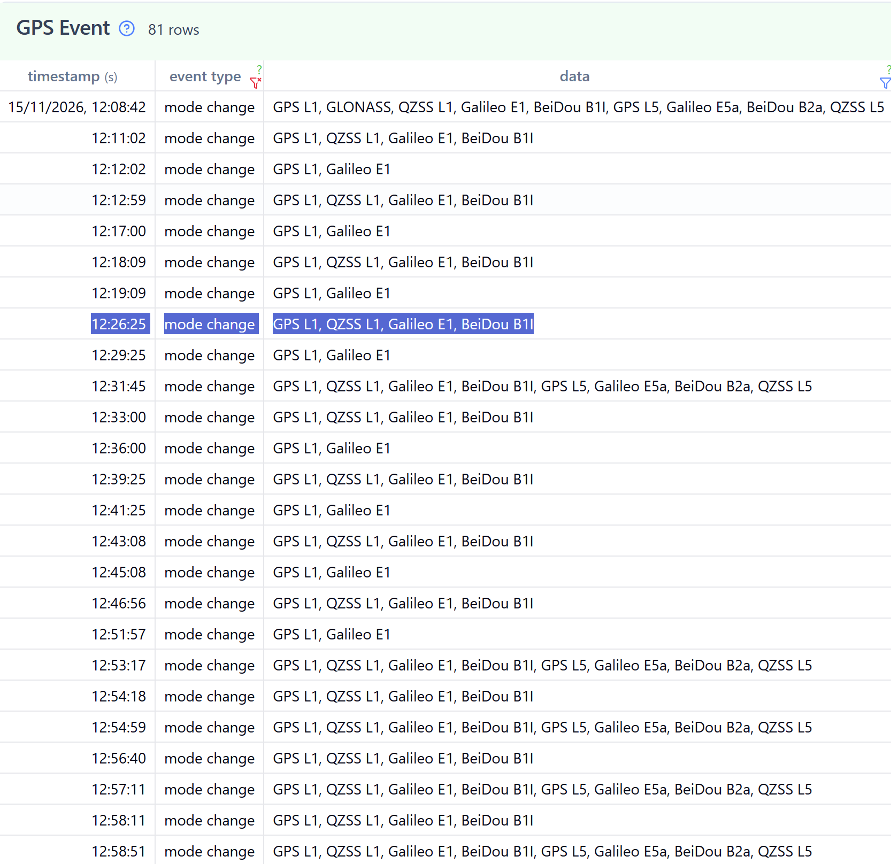

### fenix 9 Pro - Smart Recording with Spikes 

Author: Michael George

Date: 23 Nov 2026

### Background

This is a quick look at a [session](https://speedsurf.app/sessions/8fea9275-f01d-490e-b450-c4e61eacb4a2) by Pietro Sanna which was highlighted on Speedsurf.app.

An article summarises the issue as follows:

> On 15 November [Pietro Sanna](https://speedsurf.app/profile/376ae0e8-1b41-4d3e-899c-7beea802c2c9) windsurfed at Stintino, in the north of Sardinia, with a Garmin fēnix 9 Pro on his wrist. When the session came in on SpeedSurf.app, his Max 1 sec, Max 2 sec and Max 10 sec looked too high to him. So he sent us the file and asked us to check.

The article describes the general nature of this specific issue, and demonstrates one course of remedy.

These additional notes attempt to capture a possible root cause of the issues, and some recommendations.

### Dodgy Speeds

There is a period shortly after 12:26 when the Doppler-derived speeds look highly suspect, and likely elevated by 5+ knots.

Zooming in it is possible to see the Doppler-derived speeds (red) and position-derived speeds (green) are both suspect.

The session used Garmin's "smart" recording which is not the root cause of the issue, but makes it harder to diagnose.

The bigger question is why the watch misbehaved in this manner? A highly probable cause is the GNSS configuration.

### GNSS Configuration

It is very common for data issues to be caused by a GNSS configuration such as "GPS only", where even changing grip before (or after) a gybe can cause a large spike. This issue has been particularly prevalent on COROS watches such as the VERTIX, and is often remedied by GNSS configurations such as "All Systems" or "Dual Frequency".

This particular session used Garmin's regular "windsurfing" activity and thus the GNSS configuration is the responsibility of the user. The default configuration on the fenix 9 Pro is called "normal" (corresponding to the [power mode](https://logiqx.github.io/gps-details/devices/garmin/power/)) and uses what they call SatIQ. The aim is to conserve battery power and only use the full range of GNSS signals when quality drops.

This approach is fine when running or cycling, but highly undesirable for speedsurfing when accurate speeds are required every second. SatIQ will only change to the best GNSS configurations when quality drops beneath a certain threshold, but this will lead to bad data being recorded. The data quality will rarely be optimal, and some of the GNSS fixes will be of poor quality.

### GPS Events

It is possible to see when the watch was changing between different GNSS configurations using the [FIT File Viewer](https://www.fitfileviewer.com/).

During this particular session it is worth noting that when the spikes occurred it was using the most basic configuration (i.e. GPS + Galileo). The watch then decided there was a quality issue and switched to GPS + QZSS + Galileo + BeiDou.

The watch knew there was a problem with GNSS performance, so it changed the GNSS configuration accordingly.  However, it was already too late because a number of poor quality fixes had already been recorded.

n.b. We will soon lose the ability to see GPS Events in FIT files as Garmin have stopped recording them in recent firmware releases for their newest watches. This is really quite disappointing because the data is really useful for diagnostic purposes.

### Recommendations

#### GNSS Configuration

It has already been ascertained that GNSS performance can be poor when using the most basic GNSS configurations. This has been observed for COROS and Garmin watches with a variety of different GNSS chipsets.

It is therefore important to select the best possible GNSS configuration on a watch; see my  [Garmin](https://logiqx.github.io/gps-guides/guidance/garmin/) and [COROS](https://logiqx.github.io/gps-guides/guidance/coros/) advice. Garmin apps such as [APPro Windsurf](https://apps.garmin.com/en-US/apps/9567700b-6587-44be-9708-879bfc844791) (my personal favourite) and [Speedsurf.app](https://apps.garmin.com/en-US/apps/467b4e8c-a6c4-4e00-8d8e-9934a056ee8c) automatically use a suitable GNSS configuration.

#### Every Second Recording

In addition to using a suitable GNSS configuration it is important that Garmin users set their watch to "every second" recording. Garmin watches are shipped with "smart" recording as the default, but that is not appropriate when speedsurfing.

Gaps in the data will usually reduce the accuracy of results and also make it much harder to diagnose issues in the data. When data is being recorded every second it is possible to use neighbouring points to identify possible spikes, etc.

#### FIT vs GPX

Although the issues with this session are not caused by the user uploading a GPX file, many Garmin users are uploading GPX files to Speedsurf.app and thus discarding the Doppler-derived speeds from the GNSS chipset.

GPX uploads can often cause results such as the max 2 sec to be unrealistic, and there is at least one 40 knot rider who has been gifted [50 knots](https://speedsurf.app/sessions/b4d2e758-1b2c-4ff1-982c-06b7470d13ef). These inaccuracies can easily be avoided by uploading the FIT file, not the GPX. 

### Summary

It is worth bearing in mind that as a community we are using watches for a purpose they were not really designed. Whilst it is possible to get fairly reliable results from some COROS, Garmin, and Apple watches it also depends on the user.

Choosing the best possible GNSS configuration is important, and so is every second logging. Garmin do not ship their watches ready for speedsurfing, so it is up to users to set up their watches for the best chance of reliable results.

The choice of activity mode influences how Garmin and COROS process the raw data from the GNSS chipset; whether they use the Doppler-derived speeds, and whether they implement their own filtering / smoothing.

Lastly is the choice of FIT uploads over GPX uploads. Garmin do not record the Doppler-derived speeds in their GPX files so FIT uploads are the only way to ensure the Doppler-derived speeds are used for results on GPS-Speedsurfing, Speedsurf.app, etc.

The fenix 9 Pro is a new design and the entire casing is now made of titanium. It is not yet known whether this will make the fenix 9 Pro slightly more prone to spikes than the older models which used a fibre-reinforced polymer.