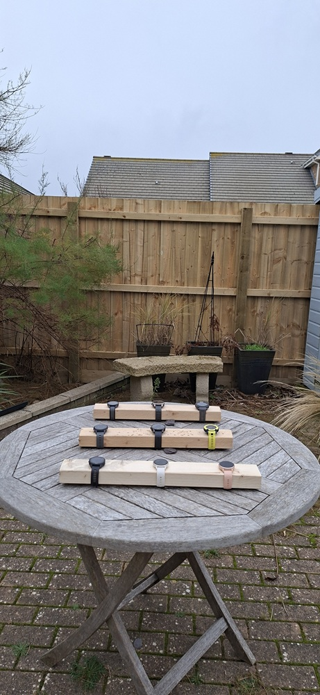
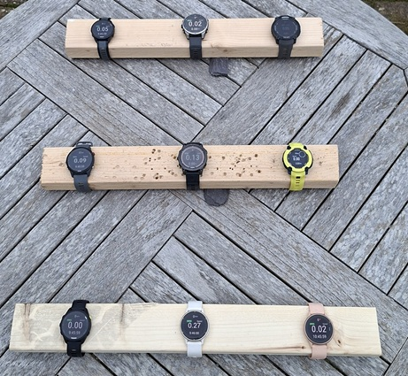
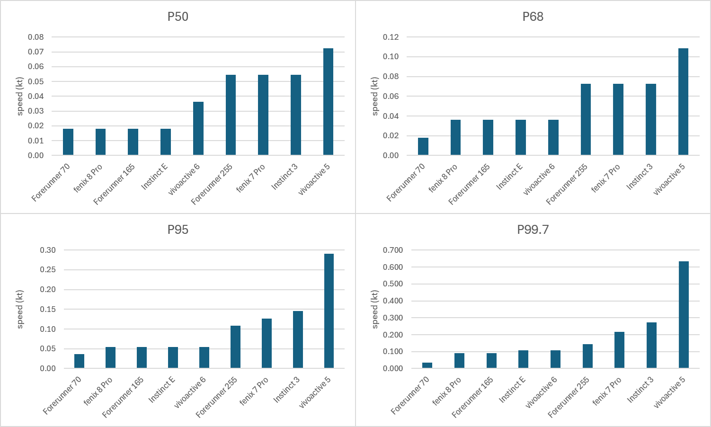
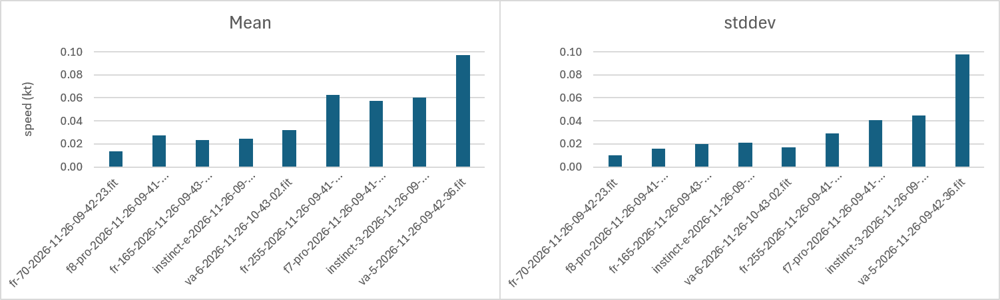
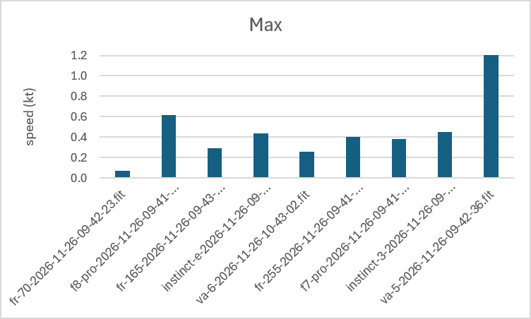

## Garmin Static Test - Airoha + Synaptics

Author: Michael George

Date: 27 Nov 2026

### Background

GPS receivers measure their speed using the observable Doppler-shift of the carrier signals. Fortunately it is possible to record these speeds from Garmin watches using a third party app such as APPro Windsurf or SpeedSurf which both record speeds in a developer fields called "sog".

Static testing is extremely effective because the GPS receivers essentially have a constant velocity, perfectly matching the rotation of the earth. The satellites are in [Medium Earth Orbit](https://en.wikipedia.org/wiki/Medium_Earth_orbit) (MEO) and the earth is rotating, but [Speed Over Ground](https://en.wikipedia.org/wiki/Ground_speed) (SOG) is zero within the [ECEF coordinate system](https://en.wikipedia.org/wiki/Earth-centered,_Earth-fixed_coordinate_system).

Previous tests for devices such as the Locosys GT-11, GT-31, GW-60, Motion GPS, and Garmin watches have all shown that performance during static testing is highly indicative of kinematic performance. The devices that perform best during static testing also tend to perform best on the water.

This particular test is a quick comparison of a number of Garmin watches that use Airoha or Synaptics GNSS chipsets.

### Watches

The following watches were included in this static test.

|        Model        | Released | Manufacturer | Chipset  | Multi-Band |
| :-----------------: | :------: | :----------: | :------: | :--------: |
|    Forerunner 70    | 2026-05  |    Airoha    |  AG3352  |     -      |
|   Forerunner 165    | 2024-02  |    Airoha    | AG3335MN |     -      |
|   Forerunner 255    | 2022-06  |    Airoha    | AG3335M  |     ✅      |
| fenix 7 Pro - 47 mm | 2023-05  |    Airoha    | AG3335M  |     ✅      |
| fenix 8 Pro - 47 mm | 2025-09  |  Synaptics   | SYN4778  |     ✅      |
| Instinct 3 - 50 mm  | 2025-01  |    Airoha    | AG3335M  |     ✅      |
| Instinct E - 45 mm  | 2025-01  |    Airoha    | AG3335MN |     -      |
|    vivoactive 5     | 2023-09  |    Airoha    | AG3335MN |     -      |
|    vivoactive 6     | 2025-04  |    Airoha    |  AG3352  |     -      |

Note: Links to teardowns and evidence of their chipsets can be found in my list of [Garmin watches](../../watches/README.md).

### Setup

The 9 watches were placed on a wooden table in the middle of my back garden. They were spaced to avoid an possibility of interreference.

Whilst it is not truly open sky it is a secure location and it is not surrounded by tall buildings.

The test allowed for a 30 minute warm up, and then ran for over 6 hours. The sky was overcast but there was no rain during the test.

All of the watches were recording the session using APPro Windsurf and showing the live speed.

### Results

The table below provides some basic stats; percentiles, means, standard devations, and maximums.

All of the results ignore the first 30 minutes of the session (warm up), and last 5 minutes (possible disturbance).

The watches recorded their speeds in m/s but the statistics are presented in knots.

| File                              | Points | P50   | P68   | P95   | P99.7 | Mean  | Std Dev | Max   |
| ---------------------------------- | :----: | :----: | :----: | :----: | :----: | :----: | :----: | :----: |
| fr-70-2026-11-26-09-42-23.fit      | 22211  | 0.018 | 0.018 | 0.036 | 0.036 | 0.013 | 0.010  | 0.073 |
| f8-pro-2026-11-26-09-41-28.fit     | 22274  | 0.018 | 0.036 | 0.054 | 0.091 | 0.027 | 0.016  | 0.617 |
| fr-165-2026-11-26-09-43-20.fit     | 22160  | 0.018 | 0.036 | 0.054 | 0.091 | 0.024 | 0.020  | 0.290 |
| instinct-e-2026-11-26-09-42-01.fit | 22234  | 0.018 | 0.036 | 0.054 | 0.109 | 0.024 | 0.021  | 0.435 |
| va-6-2026-11-26-10-43-02.fit       | 22169  | 0.036 | 0.036 | 0.054 | 0.109 | 0.032 | 0.017  | 0.254 |
| fr-255-2026-11-26-09-41-54.fit     | 22241  | 0.054 | 0.073 | 0.109 | 0.145 | 0.062 | 0.029  | 0.399 |
| f7-pro-2026-11-26-09-41-48.fit     | 22248  | 0.054 | 0.073 | 0.127 | 0.218 | 0.057 | 0.041  | 0.381 |
| instinct-3-2026-11-26-09-41-49.fit | 22254  | 0.054 | 0.073 | 0.145 | 0.272 | 0.060 | 0.045  | 0.453 |
| va-5-2026-11-26-09-42-36.fit       | 22197  | 0.073 | 0.109 | 0.290 | 0.635 | 0.097 | 0.098  | 1.215 |

n.b. Garmin watches have a quantization issue and speeds are essentially multiples of 0.00933 m/s, approximately 0.018 kt.

### Percentiles

The 9 watches have been ordered based on their P95 performance.

Due to the quantization of speeds (multiples of 0.00933 m/s, approximately 0.018 kt) some results will look more similar than the reality.

Observations:

- P50 + P68 performance of the Forerunner 255, fenix 7 Pro, and Instinct 3 are very similar
  - They differ more when you start looking at the P95 and P99.7 performance
- Performance of the fenix 8 Pro, Forerunner 165, Instinct E, and vivoactive 6 is very similar
  - They all outperform the multi-band Forerunner 255, fenix 7 Pro, and Instinct 3
- The vivoactive 6 (AG3352) performs much better than the vivoactive 5 (AG3335MN)
  - The vivoactive 6 may have also benefited from a re-design of the antenna - TBC
- The Forerunner 70 (AG3352) outperformed all other watches during this specific test

### Mean and Standard Deviation

It is also useful to review the mean and standard deviation during the test.

The same trends are evident, and in particular how the Forerunner 70 exhibited the best performance.

### Maximums

The maximums need to be taken with a pinch because they are individual outliers.

Nevertheless is it notable that the vivoactive 5 experienced the biggest outlier, and the Forerunner 70 the smallest outlier.

### Conclusions

Previous tests showed a large difference between the vivoactive 5 and vivoactive 6. The vivoactive 5 was the worst performing of all the Airoha-based Garmin watches that were tested in 2025, and the vivoactive 6 was a big improvement. It was subsequently confirmed the vivoactive 6 uses the AG3352, and this may be partially responsible for the improvement. I would not rule out other changes though, including an improved antenna design.

Since the Forerunner 70 (and 170) also uses the AG3352, I had a suspicion that it may outperform the Forerunner 165 and some of the other newer Garmin watches. This one tests suggests that the measurement of speeds may indeed have taken a leap forward with the single-band AG3352. It outperformed all of the other watches on test which all use the AG3335MN (single-band), AG3335M (multi-band), or SYN4778 (multi-band).

### Next Steps

It is important to do kinematic testing in a real-world environment. This means taking the Forerunner 70 out on the water alongside another Garmin watch and two Motion Mini devices as a benchmark.

Static testing is very useful as a quick smoke-test of a device but other factors come into play in real life; acceleration and jerk, vibration, sudden loss of signals during a crash. This static testing suggests the Forerunner 70 and 170 have great potential, but further testing remains.

